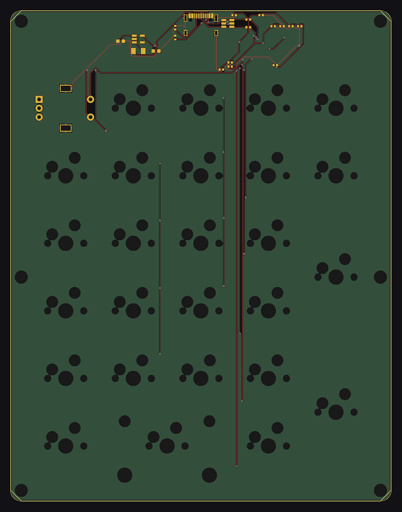
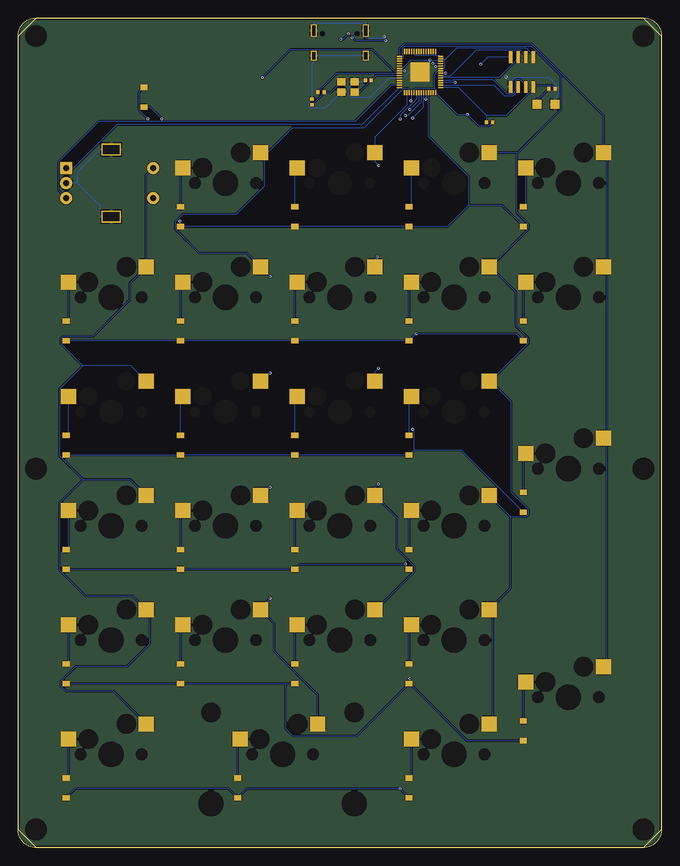

# Self-custom Macro Numpad · 自制可编程数字小键盘

> **26 键 5×6 + 左上 EC11 旋钮 · RP2040 直贴 · 热插拔 · QMK/Vial · 2 层 PCB · 6° 倾斜 · FDM 外壳**

一把自己设计的数字区小键盘：左边一列 5 颗宏键 + 顶上一排 4 颗功能键，剩下的是标准小键盘配列（`0` 为 2u、`+` 与 `Enter` 为竖 2u），左上角一个带按压的 EC11 旋钮。目标不是"比商品键盘好用"，而是**配列、倾角、内部堆叠全按自己的手型定，并且坏了能修、想改就能改**。

| | |
|---|---|
| **当前状态** | ✅ 原理图完成（ERC 0 违规，网表与设计逐网络一致）<br>✅ PCB 完成（DRC **0 违规 / 0 未连接**，Gerber 已导出）<br>⬜ 外壳 / 定位板 / 底壳（3D 模型未做）<br>⬜ 固件（QMK/Vial 键位未写）<br>⬜ 打样、装配、实测 |
| **板子规格** | 107.25 × 138.30 mm，R3 圆角，**2 层**，1.6 mm 厚，USB-C 居中后缘 |
| **主控** | RP2040（QFN-56）+ W25Q32 QSPI Flash + 12 MHz 晶振 + ME6211 3V3 LDO + USBLC6-2SC6 ESD |
| **规模** | 85 个元件、61 个网络、91 个封装（含 6 个 φ3.4 安装孔）、613 段走线、37 个过孔 |
| **许可** | GPL-3.0（见 [LICENSE](LICENSE)） |

**这是一个归档/封存仓库**：设计已完成到"可以直接下单打样"，剩下的外壳与固件没有再继续做，把过程、数据、脚本和踩过的坑完整留在这里。

## 目录

- [它长什么样](#它长什么样)
- [键盘布局](#键盘布局)
- [电气设计](#电气设计)
- [PCB](#pcb)
- [结构（七层堆叠 + 6° 倾斜）](#结构七层堆叠--6-倾斜)
- [仓库结构](#仓库结构)
- [复现：从源码到 Gerber](#复现从源码到-gerber)
- [怎么下单打样](#怎么下单打样)
- [成本](#成本)
- [踩过的坑](#踩过的坑)
- [如果要继续做](#如果要继续做)

---

## 它长什么样

| 正面 | 背面 |
|---|---|
|  |  |

原理图（A0 图幅，全部用网络标签连线，每个引脚单独标注）：[`kicad/svg_sch/numpad.svg`](kicad/svg_sch/numpad.svg) ·
[`kicad/img/sch_overview.png`](kicad/img/sch_overview.png)

正面图里那片绿色是双面 GND 覆铜（孤岛已移除），背面能看到全部焊盘与矩阵走线。

## 键盘布局

1u = 19.05 mm，键区 95.25 × 114.3 mm，坐标原点在键区左上角（`x = (col + w/2) × 19.05`，`y = (row + h/2) × 19.05`）。

```
        ┌────────┬──────┬──────┬──────┬──────┐
 row 0  │ 旋钮   │ F1   │ F2   │ F3   │ F4   │      ← 旋钮可左旋/右旋/按压（按压走矩阵）
        ├────────┼──────┼──────┼──────┼──────┤
 row 1  │ M1     │ NUM  │ /    │ *    │ -    │
        ├────────┼──────┼──────┼──────┼──────┤
 row 2  │ M2     │ 7    │ 8    │ 9    │  +   │ ┐
        ├────────┼──────┼──────┼──────┼──────┤ │ 2u 竖
 row 3  │ M3     │ 4    │ 5    │ 6    │  +   │ ┘
        ├────────┼──────┼──────┼──────┼──────┤
 row 4  │ M4     │ 1    │ 2    │ 3    │ENTER │ ┐
        ├────────┼──────┴──────┼──────┼──────┤ │ 2u 竖
 row 5  │ M5     │      0      │ .    │ENTER │ ┘
        └────────┴─────────────┴──────┴──────┘
                        (0 键 2u，跨 col1~col2)
```

- 左列 M1~M5、顶排 F1~F4 是留给自定义的余量：剪切、粘贴、撤销、计算器、媒体键，或者 tap-hold 成修饰键
- `0` 为 2u，配 PCB 卫星轴（X = 26.162 / 50.038）
- `+` 与 `enter` 是 1u×2u 竖键，不转轴、不装稳定器
- 旋钮帽 φ17（φ18 会贴到 M1 的键帽）

完整坐标表见 [plan.md §2.1](plan.md)，每颗键的开关位号、二极管、行列网络与对应 MCU 引脚见 [docs/矩阵与引脚.md](docs/矩阵与引脚.md)。

## 电气设计

**主控链路**：USB-C（16P，CC 双 5.1k 下拉）→ 1.1 A PTC 保险 → USBLC6-2SC6 ESD → 27 Ω 串阻 → RP2040 的 USB_DM/DP；RP2040 内部产生 1.1 V 内核电压，外部 ME6211 把 5 V 降到 3.3 V 供 IO 与 Flash。QSPI Flash 用 W25Q32，12 MHz 晶振配 15 pF 负载电容，BOOTSEL 用 1 kΩ + 两个短接焊盘（TP4/TP5）实现，不占体积。

**矩阵**：27 个开关（26 键 + 旋钮按压），6 行 × 5 列，`COL2ROW` 方向，每颗开关串一只 1N4148W。

| | C0 (GP8) | C1 (GP9) | C2 (GP10) | C3 (GP16) | C4 (GP17) |
|---|---|---|---|---|---|
| **R0 (GP2)** | 旋钮按压 | F1 | F2 | F3 | F4 |
| **R1 (GP3)** | M1 | NUM | / | * | - |
| **R2 (GP4)** | M2 | 7 | 8 | 9 | + |
| **R3 (GP5)** | M3 | 4 | 5 | 6 | — |
| **R4 (GP6)** | M4 | 1 | 2 | 3 | ENTER |
| **R5 (GP7)** | M5 | 0 | — | . | — |

旋钮本体的 A/B 相直接进 GP0 / GP1（不占矩阵），公共端接地。编码器按压走矩阵 R0C0，所以在 Vial 里能像普通键一样改。矩阵设计上留了 3 个空位（R3C4、R5C2、R5C4，被 2u 键的物理跨度占掉），以后想加键还有余量。

**网表**：61 个网络，无单端网络。全部连接关系见 [docs/网表.md](docs/网表.md)，元件清单见 [docs/元件表.md](docs/元件表.md)（两份都由 `gen/make_docs.py` 从 `gen/design.py` 自动生成，不手改）。

## PCB

| 项 | 值 |
|---|---|
| 外形 | 107.25 × 138.30 mm，四角 R3 圆角 |
| 分区 | 后缘 18 mm 为电子舱，前面 114.3 mm 为键区（6 mm 边距） |
| 层数 | **2 层**，1.6 mm，双面 GND 覆铜（内缩 0.4、间距 0.20、孤岛移除 ALWAYS） |
| 安装 | 6 × φ3.4 通孔，孔心距板边 3.0（上下沿 + 腰线各一对） |
| 走线 | 613 段（F.Cu 207 / B.Cu 406）、37 个过孔、线宽/间距 0.15 mm、过孔 0.45/0.25 |
| DRC | **0 违规、0 未连接**（`kicad-cli pcb drc --severity-all`） |

键区的矩阵走线由 FreeRouting 自动完成，行总线走 B 面、列总线走 F 面，行引出干挤在键区 6 mm 边距里。板子最初做成 6 层（In1 GND / In2 3V3 平面），后来发现 FreeRouting 的 613 段全部落在 F/B 两面、内层一段没用——那两块平面没有任何焊盘或过孔连进去，是孤立铜皮，于是**降回 2 层**：成本从四五百降到几十块，走线一条没重做，靠双面 GND 覆铜把回流路径补回来。

> 想更稳（比如以后要加无线、要过 EMC）随时可以改回 4 层并在键区补缝合过孔——`gen/freeroute.py --export` 之前把 `SetCopperLayerCount` 改回去即可。

## 结构（七层堆叠 + 6° 倾斜）

z 轴垂直于键面，PCB 上表面 = 0。**只有 PCB 完成了，这一节是设计意图**：

| # | 层 | 材料 | 厚度 | z 范围 | 作用 |
|---|---|---|---|---|---|
| 1 | 键帽 | PBT | 9.4~11.9 | 6.5~18.4 | — |
| 2 | **上盖压边（含顶面）** | FDM | 1.5 | 6.5~8.0 | 压住定位板 |
| 3 | **定位板** | FR4 1.5（可换铝/PC） | 1.5 | 5.0~6.5 | 手感与声音的主开关 |
| 4 | **轴间棉** | Poron | 4.5（实压 4.0~4.2） | 0.5~5.0 | 去腔音，不承力 |
| 5 | **PCB** | FR4 1.6 | 1.6 | −1.6~0 | — |
| 6 | **垫柱（刚性）** | 尼龙/黄铜 M3 | φ5 × 5.0 | 0~5.0 | 把 5.0 间距做硬、传夹紧力 |
| 8 | **底棉** | Poron / EVA | 2.5 | −4.0~−6.5 | 填腔 |
| 9 | **底壳** | FDM | 2.4（底板） | −8.9~−1.6 | 支撑边宽 4.0，顶面与键面平行 |
| 10 | **脚垫** | 硅胶 | 2.0 | −8.9~−10.9 | 防滑、找平、盖住螺丝孔 |

力路径是 `M3 螺丝 → 底壳支撑边 → PCB → φ5×5.0 刚性垫柱 → 定位板 → 上盖压边 → 铜螺母`：拔轴时 PCB 零位移，因为夹紧力由壳体和垫柱承担，不靠 PCB 的弯曲刚度。

**倾斜**：底面水平、键面 6° 前低后高。前缘 21.4 / 后缘 34.6（含脚垫），前后高差 13.3 mm。倾角只改 3D 模型，不动 PCB。

> 曾评估过 gasket（硅胶条上下夹、内胆上浮 ≤0.30），结论记在 [plan.md §5.3](plan.md)：能换更软的手感，但装配容差和"内胆会不会晃"的风险更高，最终选硬夹。

## 仓库结构

```
.
├── README.md              # 本文件：总览、结论、复现步骤
├── plan.md                # 设计文档：布局/矩阵/结构/层叠/倾角/材料/BOM（含 v0.1→v1.0 变更记录）
├── pcb-status.md          # PCB 实现现状、DRC 分类、KiCad 10 工具链坑
├── docs/
│   ├── 元件表.md           # 85 个元件（自动生成）
│   ├── 网表.md             # 61 个网络逐引脚（自动生成）
│   ├── 矩阵与引脚.md        # 键位 → 开关 → 二极管 → 行列 → MCU 引脚（自动生成）
│   ├── 成本核算.md          # 自己做 vs 买成品：逐项账本、差额、隐性成本
│   └── 调研-*.md           # 2026-11-14 行情调研原始记录（打板贴片 / 成品对标 / 零件打印）
├── gen/                   # 生成器：唯一真值源 + 全流程脚本
│   ├── design.py          # ★ 元件表 + 网络表 + 键位坐标 + GPIO 映射（改设计只改这里）
│   ├── sexpr.py           # 极简 S 表达式读写器
│   ├── sch.py             # 原理图生成（库符号内嵌 + 网络标签连线）
│   ├── check_sch.py       # 原理图回归：ERC + 导出网表与 design.py 比对
│   ├── build_pcb.py       # PCB 生成：板框、叠放、网络赋值、叠放自检
│   ├── freeroute.py       # DSN 导出 / SES 回灌 / 收口（铺铜、层数）
│   ├── render.py          # Pillow 自绘顶/底/叠合视图
│   ├── drc_hot.py         # DRC 报告按网格聚类看热点
│   ├── drc_map.py         # 把 DRC 标记叠到板子截图上
│   ├── geom.py            # 布线几何预检（线段-矩形、线段-线段、板边）
│   ├── make_docs.py       # 生成 docs/ 下三份表格
│   ├── route.py           # 【归档】手写矩阵布线器，已被 FreeRouting 取代
│   └── probes/            # 【归档】探索期探针脚本（KiCad API 语义验证）
├── lib/numpad.pretty/     # 自制封装：热插拔座、2u 稳定器、φ3.4 安装孔
└── kicad/
    ├── numpad.kicad_pro   # 工程设置（网类、DRC 规则引用）
    ├── numpad.kicad_sch   # 原理图（A0，生成物）
    ├── numpad.kicad_pcb   # PCB（生成物 + FreeRouting 布线结果）
    ├── numpad.kicad_dru   # 自定义工艺规则（0.15 间距/线宽、0.45 过孔等）
    ├── numpad_lib.kicad_sym / sym-lib-table / fp-lib-table
    ├── numpad.net         # 原理图导出网表（与 design.py 一致）
    ├── numpad.dsn / .ses  # FreeRouting 输入 / 输出
    ├── drc.rpt / erc.rpt  # 最近一次检查报告
    ├── gerber/            # ★ 生产资料（直接下单用，含 .gbrjob 与钻孔）
    ├── gerber.zip         # 上面这份打了个包
    └── img/ · svg_sch/    # 渲染图与原理图 SVG
```

`gen/` 里所有脚本都以 `design.py` 为唯一真值源——元件、网络、键位坐标、GPIO 映射只写一遍，原理图、PCB、文档全部由它派生。

## 复现：从源码到 Gerber

环境：**KiCad 10.0.8**（含自带 Python 3.11 + `pcbnew` 模块）、**FreeRouting 1.9.0**（`-mt 1`，JDK 17）。全部命令在仓库根目录执行，`PY` 指 KiCad 自带的 python。

```bash
# 1) 原理图（生成物，重跑会覆盖 kicad/numpad.kicad_sch）
$PY gen/sch.py
# 2) 原理图回归：ERC 必须 0 违规，且导出网表与 design.py 的 61 个网络逐一对齐
$PY gen/check_sch.py

# 3) PCB 骨架：板框、叠放、网络赋值、courtyard 重叠自检
$PY gen/build_pcb.py --place
# 4) 导 DSN（顺带把网类设成 0.15 / 0.15 / 0.45:0.25）
$PY gen/freeroute.py --export
# 5) 外部自动布线（单线程；多线程会自己警告会出间距违规）
java -jar freerouting-1.9.0.jar -de kicad/numpad.dsn -do kicad/numpad.ses -mp 30 -mt 1
# 6) 回灌 SES + 收口（降到 2 层、双面 GND 覆铜、填铜）
$PY gen/freeroute.py --import

# 7) 验收
kicad-cli pcb drc --severity-all kicad/numpad.kicad_pcb     # 期望 0 违规 0 未连接
# 8) 出生产资料与图
kicad-cli pcb export gerbers -o kicad/gerber kicad/numpad.kicad_pcb
kicad-cli pcb export drill  -o kicad/gerber kicad/numpad.kicad_pcb
$PY gen/render.py
# 9) 文档表格（改过 design.py 后重跑）
$PY gen/make_docs.py
```

两个必须记住的顺序约束：

- **`build_pcb.py --place` 只能跑一次再布线**：它每次都会重建整块板，布线后再跑会把走线丢掉。
- **`freeroute.py --import` 需要完整的板**：脚本里加了"封装数 < 50 拒绝回灌"的保护，因为半成品/空板上回灌会产生一堆无网络走线和假的 DRC 结果。

## 怎么下单打样

`kicad/gerber.zip` 直接丢给嘉立创/立创商城，参数：

| 项 | 值 |
|---|---|
| 层数 / 尺寸 | 2 层 / 107.25 × 138.30 mm |
| 板厚 | 1.6 mm |
| 最小线宽/间距 | 0.15 / 0.15 mm |
| 最小孔径 / 过孔 | 0.25 / 0.45 mm |
| 表面处理 | 无铅喷锡即可，想手感更好可选沉金 |
| 建议 | **RP2040 那面交给 SMT 贴片**（QFN-56 是 0.4 mm 脚距，手焊是这块板唯一的硬骨头）；热插拔座、二极管、USB-C、编码器自己焊，都是简单活 |

## 成本

按 2026-11-14 现抓报价核算（打板、贴片、零件、打印逐项有出处）：

| | 金额 |
|---|---|
| 自制一把（首单买齐，经济档 / 手感档） | **¥490 / ¥790**（中位 ¥640） |
| 摊薄到 3 把 | ¥286 / ¥506 每把 |
| 最接近的成品（佐亚 GMK26，26 键 + 旋钮 + QMK/VIA + 热插拔） | **¥166~189** |
| 差额 | **贵 ¥300~600，约 2.6~4.2 倍** |
| 唯一打平的对标（铝壳 Keychron Q0 Plus，做 2~3 把时） | ¥358 |

**结论：自己做不省钱。** 成本大头不是打板（¥60）也不是贴片（¥80），而是轴、键帽、棉、外壳、运费这些"零售价"；省下来的是配列自由度、可修可改，以及"这是我做的"。若还要算，工具 ¥185~255、工时 8~15 小时、一次改板返工 ¥60~120 都没进表。

完整账本、三个反直觉发现、什么情况下自己做才划算 → **[docs/成本核算.md](docs/成本核算.md)**（含 `+`/`Enter` 为什么不装稳定器、卫星轴只需 1 对的原因）。

## 踩过的坑

把会重复踩到的写在这里，细节在 [pcb-status.md](pcb-status.md)：

**KiCad 10 的 `pcbnew` SWIG 接口**
- `fp.Remove(child)` 之后，该封装**所有**取值器（`GetPosition`、`GetBoundingBox`…）都退化成裸 `SwigPyObject`。改封装内容只能 `SetLayer`（挪层），不要删。
- 在同一封装上先调 `GetReference()` / `GetPadCount()`，会让 `GraphicalItems()` 变成不可迭代对象。
- `pcbnew` 里没有 `FP_TEXT`，图形要按 `type(g).__name__` 判 `PCB_TEXT` / `PCB_FIELD`。
- `GetDefaultNetclass()` 已删除，用 `GetAllNetClasses()['Default']`；`ZONE` 的图层要用 `LSET()` + `AddLayer()` 设。
- `PCB_VIA.GetWidth()` 不带图层参数会触发 wxWidgets 断言弹窗，必须 `GetWidth(pcbnew.F_Cu)`。
- 带 zone 的板子用 `board.Save()` 会崩，改用 `pcbnew.SaveBoard(path, board)`。
- 自定义 `.kicad_dru` 若带 UTF-8 BOM，整份规则会被**静默忽略**（症状是所有过孔突然报 `via_diameter`）——用 `write` 工具或 `newline='\n'` 落盘，别用 PowerShell `Set-Content -Encoding UTF8`。

**FreeRouting**
- **2.5.0 的 GUI 读不了 KiCad 10 的 DSN**：会提示 `91 session item(s) were skipped due to unresolved reference, layer, or padstack`，即全部元件都没加载（91 正好是全板封装数）。同一份文件用 1.9.0 的 CLI 正常。**只用命令行。**
- `-mt 8` 时 FreeRouting 自己会警告"多线程优化会生成间距违规"；实测耗时和 `-mt 1` 差不多，直接用单线程。
- 它只在最外层走线，内层平面不会被连进去——要么给它 2 层板，要么记得人工补缝合过孔。

**工艺规则**
- 网类存在 `.kicad_pro` 里，`SaveBoard` 不写它，所以 DRC 可能仍按 0.2 mm 判定；用 `numpad.kicad_dru` 的规则覆盖。
- USB-C 16P 公版封装自带的 A1/A12 焊盘离外壳固定孔只有 0.1847 mm，是封装特性不是布线问题——规则改到 0.15 即可。
- 键位丝印字是 `silk_overlap` 的主要来源（26 个键名产生 50 条警告），装键帽后也看不见，直接不画。

## 如果要继续做

按优先级：

1. **外壳 / 定位板 / 底壳**：全部坐标要按新的 **107.25 × 138.30** 重算（早先按 134.30 设计，电子舱从 14 加长到 18 mm）。要做的开孔：26 个 MX 方孔 + 旋钮孔 + 旋钮凸台、2u 卫星轴开槽、6 个 M3 沉头孔与铜螺母位、USB-C 后缘开窗、6° 斜面与 45° 支撑筋斜切、后腔填充块。
2. **固件**：QMK + Vial。矩阵按 [docs/矩阵与引脚.md](docs/矩阵与引脚.md)，`DIODE_DIRECTION COL2ROW`、去抖 3 ms、扫描 1 kHz；编码器 A/B 在 GP0/GP1，按压在矩阵 R0C0。Vial 的键位表可以直接按 [plan.md §2.1](plan.md) 的坐标表生成。
3. **打样与装配**：先打 5 片 PCB + 1 块 FR4 定位板，用便宜轴和键帽验证装配与固件，再换好轴好帽。
4. 可选升级：改回 4 层 + 缝合过孔；加 OLED（I2C 的 GP19/GP20 已预留但未接网络）；加 RGB（GP18 同样预留）。

---

*设计、布线、文档由 [`gen/`](gen/) 下的脚本生成；所有尺寸与网络数据以 [`gen/design.py`](gen/design.py) 为准。*
