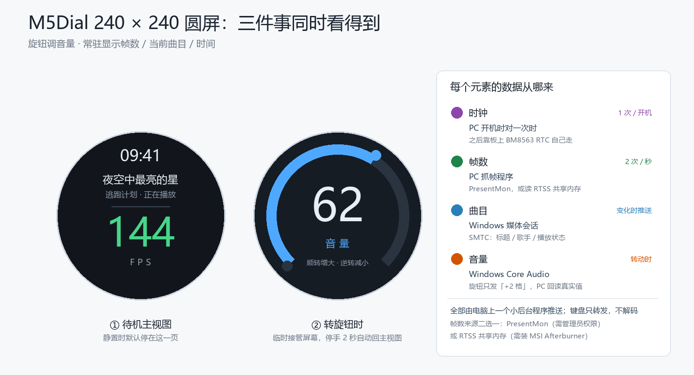
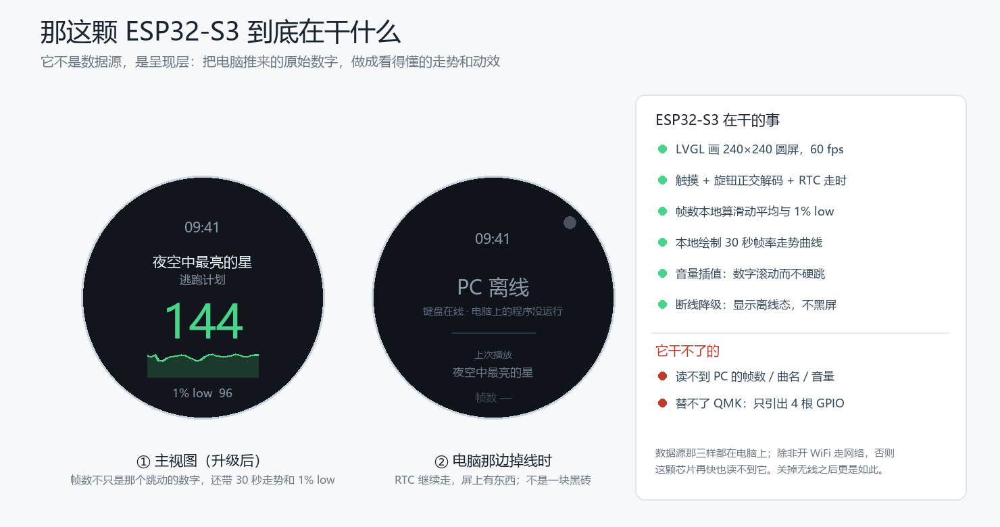

# 功能与屏幕方案

> 2026-11-15。回答一个问题：**这个拨盘到底干什么、数据从哪来、谁负责什么。**
> 产品定义：旋钮调音量；屏幕常驻显示 **游戏帧数 / 当前播放曲目 / 时间**。

## 0. 一句话

它不是一个"多功能小电脑"，是**键盘上的一块常驻仪表盘 + 一个音量旋钮**。

## 1. 屏幕有哪几页

| 页 | 何时出现 | 内容 |
|---|---|---|
| **主视图** | 静置时默认 | 时钟 · 曲名 / 歌手 · 大号帧数 |
| **音量视图** | 转旋钮时接管 | 环形进度 + 百分比；停手 2 s 自动回主视图 |
| 播放控制（可选） | 短按 / 触摸 | 上一首 / 播放暂停 / 下一首 |

交互按优先级：

| 操作 | 动作 |
|---|---|
| 转旋钮 | 音量 ±1 格 = ±2%，屏上立刻显示 |
| 短按 | 播放 / 暂停（默认），或切页 |
| 长按 | 切页 |
| 触摸 | 切页（M5Dial 是触摸屏，不用额外器件） |

## 2. 每个元素的数据从哪来

### 2.1 时间 —— 最省事

PC 开机时推一次 UNIX 时间戳，**之后靠 M5Dial 板载的 BM8563 RTC 自己走**。断线也在走，重连再对一次。不需要每秒推。

### 2.2 帧数 —— 唯一有门槛的一项

游戏帧数**只有电脑知道**，设备端无论怎么写都拿不到。三条路：

| 方案 | 原理 | 需要什么 | 评价 |
|---|---|---|---|
| **RTSS 共享内存（先做这个）** | 读 `RTSSSharedMemoryV2` 内存映射，`dwFrames` 两次采样求差 | 用户装 MSI Afterburner 并开 RTSS | **零权限、几十行代码**，最省事 |
| PresentMon | ETW 抓每一次 Present | **通常要管理员权限** | 最准，能算 1% low，可后加 |
| 游戏内自报 | 没有通用接口 | — | 不可行 |

推送 **2 Hz** 就够：人眼读数字不需要更快，屏幕刷新和串口带宽也都是这个量级。

> 老实说清楚：想让帧数显示出来，**电脑上必须常驻一个小程序**。这不是设计缺陷，是"帧数只存在于 PC"这个事实决定的。

### 2.3 当前曲目 —— Windows 现成的

Windows 10/11 的 **SMTC**（`GlobalSystemMediaTransportControlsSessionManager`）直接给：标题、歌手、专辑、播放状态、甚至专辑封面。

- **变化时推送**，不用轮询
- Python 用 `winsdk`（`Windows.Media.Control`），中文歌名 UTF-8 直传，没有编码坑
- 网易云 / QQ 音乐 / Spotify / 浏览器都支持 SMTC

### 2.4 音量 —— 两条路，取折中

| 路线 | 做法 | 优点 | 缺点 |
|---|---|---|---|
| **A（默认）** PC 程序设音量 | 设备发「+2 格」→ PC 程序用 `pycaw` 设 Core Audio | 精确 2%，能立刻回读真实值显示 | 依赖 PC 程序在跑 |
| **B（兜底）** 设备发 HID 多媒体键 | 走系统原生音量键 | PC 程序挂了也能调 | 拿不到绝对值回显，步进由系统定 |

**默认 A，PC 程序没跑时自动退回 B。** 这样既不依赖后台程序，又能在正常运行时精确显示。

## 3. 三个部分各干什么

| 谁 | 干什么 | **不**干什么 |
|---|---|---|
| PC 后台程序 | 抓帧数、读曲目、读写音量、打包推送 | 不画 UI、不管屏幕 |
| RP2040（键盘） | 键位、旋钮 → 音量事件、把 PC 报文转发到 UART | 不解析曲名、不画界面、不做系统调用 |
| M5Dial | 收报文、画界面、上报旋钮和触摸 | 不联网、不调系统 API |

**关键分工**：屏幕的"内容"由 PC 决定，"样子"由 M5Dial 决定，中间的 RP2040 只管搬。

### 3.1 ESP32-S3 不是空转

会有个疑问：一颗双核 240 MHz、带 WiFi/BLE 的芯片，就用来"收几条报文画个图"，是不是浪费？

**如果只做收报文画图，确实是浪费。** 所以方案给它派了这些活——都是"用本地算力换观感"，不增加 PC 侧负担：

| 它干的活 | 为什么值得 |
|---|---|
| LVGL 渲染 240×240 圆屏 @60 fps | 抗锯齿、动画、圆角，全靠它 |
| 触摸 + 旋钮正交解码 + BM8563 走时 | 三个外设都在它这边 |
| **帧数本地算滑动平均与 1% low** | PC 只推瞬时值，屏上给出的是"稳不稳"，不是一个乱跳的数字 |
| **本地绘制 30 秒帧率走势** | 曲线是本地画的，一个字节都不用多传 |
| **音量插值**：数字滚动、环平滑推进 | 转一格不会硬跳一格，观感差别很大 |
| **断线降级**：显示离线态而不是黑屏 | 把单点故障变成优雅降级 |
| 双核分工：core0 画 UI / core1 收串口 | 转旋钮时界面不掉帧，串口不丢包 |

**它做不到的两件事，得说清楚：**

1. **读不到 PC 的帧数 / 曲名 / 系统音量。** 这三样的源头都在电脑上，这颗芯片再快也够不着。除非开 WiFi 走网络——而你已经定了不开无线。
2. **替不了 QMK。** M5Dial 只引出 4 根 GPIO，扫不动 7×6 矩阵；就算用 I2C 扩展绕过去，也等于放弃 Vial 改键。

所以它的定位是**呈现层 + 交互层**，不是数据源。这块屏好不好用，八成取决于它把原始数字加工得怎么样。

## 4. 报文

沿用 v4 的帧格式 `AA 55 | LEN | TYPE | PAYLOAD | CRC8`，一包要塞进 raw HID 的 64 字节。

| 字段 | 字节 | 说明 |
|---|---|---|
| 音量 | 1 | 0~100 |
| 标志位 | 1 | 静音 / 播放中 / PC 程序在线 |
| 帧数 | 2 | 0~999，0 表示没在游戏 |
| 时间 | 4 | UNIX 秒 |
| 标题 | 24 | UTF-8，最多 8 个汉字 |
| 歌手 | 16 | UTF-8，最多 5 个汉字 |
| **合计** | **48** | 加 4 字节头 = 52 ≤ 64 ✓ |

2 Hz 推送 = 约 110 B/s。RTSS、UART 115200、屏幕刷新都远远吃得下——**带宽从来不是这个项目的瓶颈，器件数量才是。**

## 5. 界面细节

- 帧数配色：**≥120 绿 / 60~119 蓝 / <60 橙**
- 标题超长时尾部省略或缓慢横向滚动
- 没有播放时，曲目区显示「未在播放」，不留空
- PC 程序掉线时，右上角显示一个灰点，其余照常显示（时间还在走）

## 6. 工作量（粗估，按你一个人写）

| 部分 | 工时 |
|---|---|
| PC 后台程序（RTSS 读数 + SMTC + pycaw + HID 推送） | 1~2 天 |
| RP2040 转发层（QMK raw HID + UART） | 半天 |
| M5Dial UI（LVGL 画三页） | 2~3 天 |
| 联调 + 边角情况 | 1 天 |

## 7. 这个需求把架构选择定了

**结论：走 v4（M5Dial 不做 USB 设备），理由比之前更硬。**

1. **数据量极小**（<200 B/s），完全用不上 USB 带宽
2. **屏幕的信息全部来自 PC**，它自己独立枚举成设备没有任何价值——就算独立了，PC 上那个程序照样得跑
3. 省掉 Hub + 晶振 + 第二个 USB-C + 两套 CC 电阻 + 限流 + 第二套 ESD，**五类翻车点一起消失**
4. 唯一代价是"键盘固件挂了屏幕黑"——但那种时候游戏也停了，帧数本来就没意义

## 8. 还没定的

1. 短按是「播放/暂停」还是「切页」？（触摸也能切页，可能有重复）
2. 触摸屏要不要用起来，还是只当显示？
3. 除了这三样，要不要加 CPU 温度 / 风扇转速 / 天气
4. 帧数用 RTSS 起步，还是直接上 PresentMon
