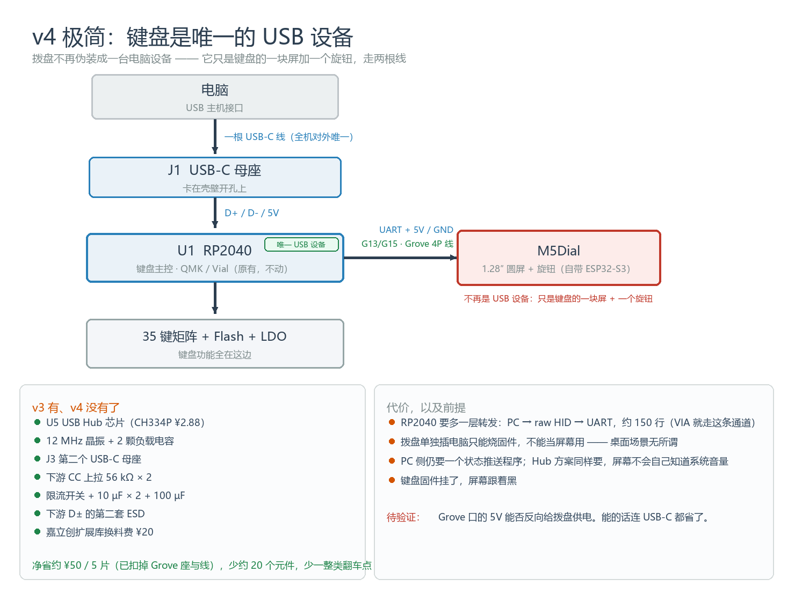

# 布局方案 v4：极简架构

> 2026-11-15。**布局沿用 v3**（四块岛 + 十字沟槽 + 145.20 × 164.25），本文只重写电气与拨盘连接方式。
> 一句话：**M5Dial 不再是一台 USB 设备，它是键盘的一块屏。**



## 0. 为什么推翻 v3 的电气

v3 为了"一根线"，在板子上摊开了一整套 USB 子系统：Hub 芯片 + 12 MHz 晶振 + 第二个 USB-C 母座 + 两套 CC 电阻 + 限流开关 + 100 µF + 第二套 ESD。它存在的唯一理由是——**让一台 88 mA 的小屏能被电脑单独认出来**。

但前提已经变了：M5Dial **只走有线、不开射频**。一个只显示、只发旋钮事件的模块，没有任何理由要自己的 USB 身份。它需要的只有三样：**5V、两根数据线、一个外壳开孔。**

把它当第二台电脑设备对待，才是 v3 笨重的根源。

## 1. 架构对比

| 项 | v3 | **v4** |
|---|---|---|
| USB 设备数量 | 2（键盘 + 拨盘） | **1（只有键盘）** |
| Hub 芯片 | CH334P + 12 MHz 晶振 | **无** |
| 第二个 USB-C 母座 | J3 | **无** |
| 拨盘怎么连 | 机内 USB-C 短线（数据 + 供电） | **Grove 4P 四芯线（UART + 5V）** |
| 拨盘怎么识别成设备 | 电脑枚举成独立 HID | **不枚举，RP2040 转成 HID** |
| 下游 CC 电阻 / 限流 / ESD | 各一套 | **全无** |

## 2. 省掉的元件（逐项）

| 元件 | 作用 | 单价 |
|---|---|---|
| CH334P | Hub 主控 | ¥2.88 |
| 12 MHz 3225 晶振 | Hub 时钟 | ¥1.50 |
| J3 USB-C 16P | 下游口 | ¥1.50 |
| 56 kΩ × 2 | 下游 CC 上拉 | ¥0.10 |
| SY6280AAC + 10 µF × 2 | 下游限流/软启动 | ¥1.00 |
| 100 µF | 下游储能 | ¥0.30 |
| USBLC6-2SC6 | 下游 ESD | ¥1.00 |
| **合计** | | **约 ¥8.3 / 片** |

5 片省约 ¥41，加上**不再需要嘉立创扩展库换料费 ¥20**，共省 ¥61；扣掉新增的 Grove 4P 座（¥1/片）和一根 Grove 线（¥8），**净省约 ¥50**。

顺带 SMT 焊点少约 25 个。

## 3. 换来什么（比省钱重要）

**① 少了一整类翻车点，不是一个点。** v3 里最容易出事的五件事全部消失：CC 电阻接反、总线/自供电上报、每口 100 mA 预算、下游热插拔浪涌、拔线反灌。这些坑每一条都能让板子回来不亮。

**② 布线难度断崖下降。** 下游那段从"USB 差分对 + ESD + 阻抗控制"降级成两根普通走线。

**③ 结构上少一根硬插头。** v3 要在壳里给 USB-C 插头留 12 mm × 25 mm 径向通道，还要买 90° 弯头。Grove 线是软线，可以从任意角度弯出去，通道只要 6 mm 见方。

**④ 拨盘不再是黑盒。** 它和键盘之间有明确的报文协议，屏幕上要显示什么完全由键盘决定，调试时能抓串口。

## 4. 代价（不藏）

1. **RP2040 要加一层转发**：PC → raw HID → UART → 拨盘。约 150 行 C。QMK 的 raw HID 是现成的（VIA 就走这条通道），不用另起炉灶。
2. **拨盘单独插电脑只能烧固件**，不能当屏幕用。桌面场景无所谓。
3. **PC 侧仍要一个状态推送程序**。注意：Hub 方案同样要——HID 设备不会自己知道系统音量，两个方案这笔账一样。
4. **键盘固件挂了，屏幕一起黑**。

代价换来的是：全机一颗 MCU、一个 USB 口、零 Hub。

## 5. 固件契约

### 5.1 连接

| 方向 | 通道 |
|---|---|
| PC → 键盘 | USB raw HID（`RAW_ENABLE = yes`，VIA 同款），32/64 字节报文 |
| 键盘 → 拨盘 | **UART 115200 8N1**，RP2040 侧用两个空闲 GPIO，拨盘侧用 Grove 的 **G13 = RX / G15 = TX** |
| 拨盘 → 键盘 | 同一条 UART 反向 |

Grove 4P 引脚：黑 GND / 红 5V / 黄 G13 / 白 G15。ESP32-S3 的 GPIO matrix 允许把任意 GPIO 映射到 UART，G13/G15 在 M5Dial 上专供 PORT.A，没有别的占用。

### 5.2 帧格式

定长二进制，不用 JSON（避免解析开销和截断风险）：

```
AA 55 | LEN | TYPE | PAYLOAD... | CRC8
```

| TYPE | 方向 | 内容 |
|---|---|---|
| 0x01 | PC→键盘→拨盘 | 系统状态：音量、静音、媒体播放态、前台应用名（截断 32 字节） |
| 0x02 | 拨盘→键盘 | 旋钮事件：±N 格 |
| 0x03 | 拨盘→键盘 | 触摸 / 按键事件 |
| 0x04 | 双向 | 心跳，2 s 一次，丢 3 次就报"屏幕离线" |

### 5.3 旋钮怎么变成音量

拨盘只把"转了 +2 格"发上来，**由 RP2040 发 HID 多媒体键（音量 +2）**。这样电脑侧不需要任何驱动，也不需要键盘固件之外的东西。整链路延迟约 2~3 ms，转起来不会有滞后感。

## 6. 供电

5V 从板子的 5V 轨经一颗 **350 mA PTC** 走 Grove 红线到拨盘。

- 拨盘典型 88 mA、峰值约 130 mA（无射频）
- 350 mA 的 PTC 在 45 ℃ 壳温下保持电流约 245 mA，够用且不会误跳
- Grove 5V 与 GND 之间挂 **10 µF**，就近吸收拨盘上电那一下
- **不给拨盘装电池**：装了只会多 100 mA 充电电流，桌面设备不需要

## 7. 还没验证的两件事

1. **Grove 的 5V 能不能反向输入。** M5Dial 的 PORT.A 5V 在资料里标的是"5 V supply"（输出）。如果它能当输入（M5Stack 有些机型可配置），那就连拨盘的 USB-C 都不用插——**一根 Grove 线同时给电和数据**，整机彻底只剩一个对外 USB 口和一根内部软线。查 `Sch_M5Dial.pdf` 或实测即可定论。
2. **G13/G15 上电时的默认电平**。UART 空闲是高电平，若拨盘侧或键盘侧有上拉/下拉冲突，需要在固件里先配置再开串口。实测一次就清楚。

## 8. 与 v3 的关系

- **布局图完全不变**：[layout_v3.png](../img/layout_v3.png) 照用
- **PCB 要做的事反而变少**：v3 本来就要重画，v4 只是少画一个 Hub 子系统
- v3 文档保留作对照：[布局方案-v3.md](布局方案-v3.md)
